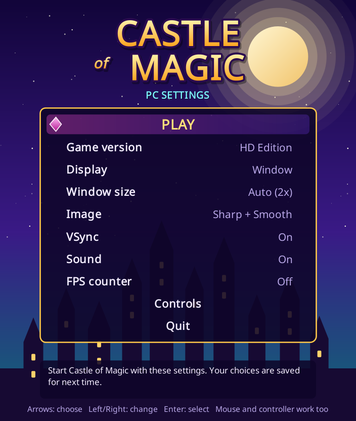

# Castle of Magic – PC version

A Windows PC package for Castle of Magic (Gameloft, 2008, J2ME). Personal use only.

- Double-click `CastleOfMagic.exe`; a PC settings screen opens first (F1 reopens it in-game).
- The original game files are used unchanged: Normal (240x320) and HD (352x416).
- Online multiplayer (Normal version): each player runs their own game; the friend appears as a yellow hero
  with a name tag when you are in the same place. Uses the room server in
  [TrishaAdio/CastleApi](https://github.com/TrishaAdio/CastleApi). The host's save is copied to the friend on join.
- GPU scaling with 4 filters, fullscreen/window, VSync, XInput controllers, FPS counter, screenshots.
- Bundled Java runtime, so nothing needs to be installed.



## Installing

Run `CastleOfMagic-Setup.exe`. It installs into `%LOCALAPPDATA%\Programs\Castle of Magic` (no admin rights),
adds a desktop and Start menu icon, and an entry in Windows "Installed apps" for uninstalling.
Running a newer setup updates the game and keeps saves and settings.

## Building

The original game jars are **not** in this repo. Put them in a folder and run:

```sh
./build.sh "/path/to/folder with Castle of Magic jars"
```

It expects `Castle of Magic (2008)(Gameloft SA)(v1.0.2)(a8).jar` and `...(a9).jar`.
Needs JDK 25, Go 1.22+, git, curl, unzip and zip. Output: `dist/CastleOfMagic-PC.zip` and `dist/CastleOfMagic-Setup.exe` (installer source in `installer/`).

Player instructions: [README.txt](README.txt). Developer notes: [NOTES.md](NOTES.md).

## Credits
- Phone runtime: [FreeJ2ME-Plus](https://github.com/TASEmulators/freej2me-plus) (GPLv3), downloaded at build time.
- Java runtime: Eclipse Temurin 25.
- Castle of Magic is (c) 2008 Gameloft.
